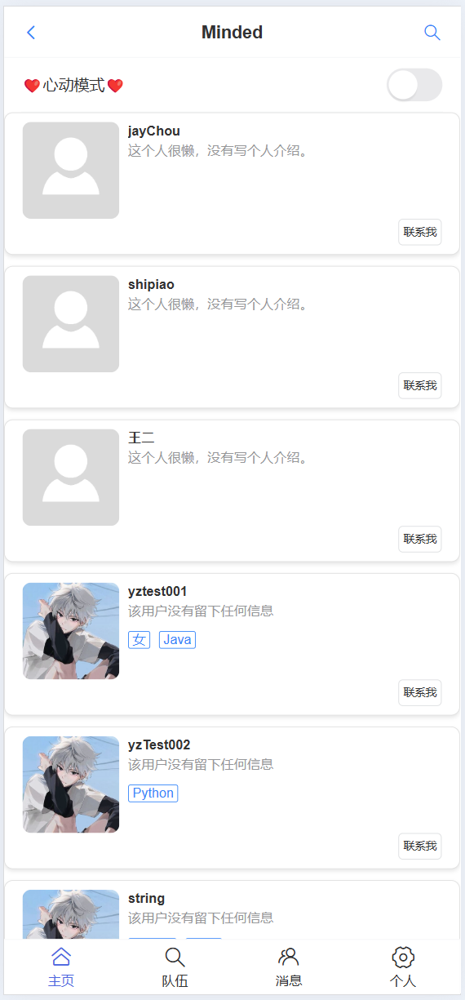
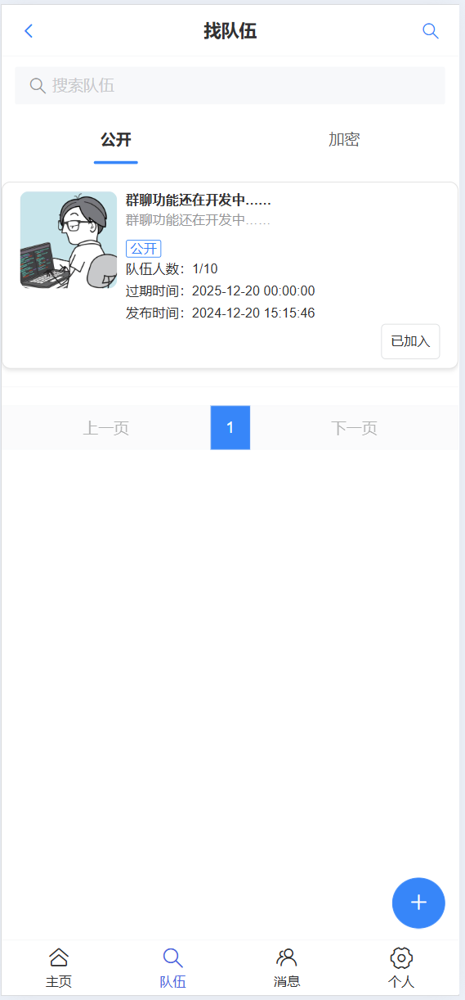
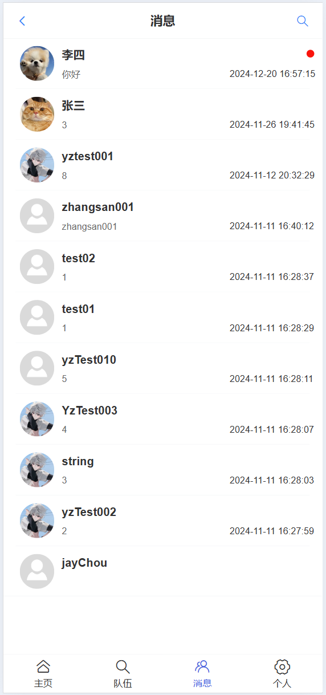
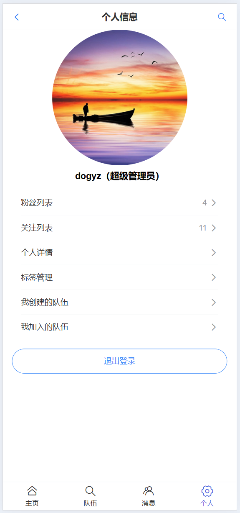
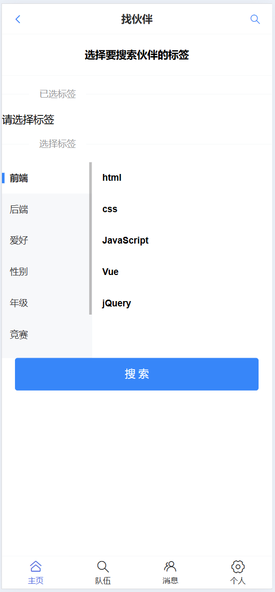

# Minded伙伴匹配

网站：[http://120.55.73.95:8081/user/login](http://120.55.73.95:8081/user/login)

> 项目运行之前先将需要修改配置项修改成自己的

---

### 介绍

Minded伙伴匹配系统,帮助大家找到学习伙伴的移动端 H5 网站（APP 风格）网页  
实现了以下功能，用于帮助用户匹配与自己相似的用户，一起学习、竞赛，共同进步。

+ 用户可以设置自己账号的标签，可以根据自己的标签匹配与自己最相似的用户、根据标签搜索用户，找到志同道合的伙伴。
+ 用户能够组队，创建自己的队伍、查找队伍，找到一起参加竞赛的伙伴，告别孤军奋战。
+ 用户还可以关注其他用户，与其他用户用户私聊。

### 软件架构

基于 Spring Boot 后端 + Vue3 前端的 全栈项目，包括用户登录、更新个人信息、按标签搜索用户、建房组队、推荐相似用户、用户之间的私聊等功能。

### 技术选型

#### 前端

+ Vue3 前端框架
+ VantUI 移动端 H5 组件库
+ Ajax

#### 后端

+ SpringBoot
+ MySQL
+ Redis
+ MyBatis-Plus
+ WebSocket 通信协议
+ 阿里云 OSS 远程对象存储

### 项目笔记

[https://www.yuque.com/u46466642/ll1qgb/mg8nrt6teiqpl2i0](https://www.yuque.com/u46466642/ll1qgb/mg8nrt6teiqpl2i0)

还在整理当中

